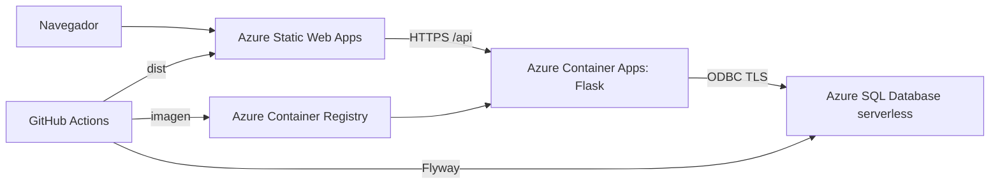

# Despliegue de demostración en Azure

> **Estado actual:** esta guía conserva instrucciones de una versión anterior y no
> describe el despliegue existente. El servidor SQL de la demo usa autenticación
> exclusiva de Microsoft Entra y el backend usa identidad administrada. No ejecute
> el workflow `Deploy Azure` ni los comandos de aprovisionamiento de esta guía hasta
> que se actualicen para esa infraestructura. La publicación actual es manual.
> El estado de Terraform contiene datos sensibles y permanece local; no debe
> compartirse ni añadirse a Git.



## Recursos

Ejemplo Bash; seleccione nombres globalmente únicos y una región compatible. Revise costos y elegibilidad antes de crear recursos. La oferta gratuita requiere `--use-free-limit true`; `AutoPause` suspende al agotar el límite mensual. Consulte [Azure SQL free tier](https://learn.microsoft.com/azure/azure-sql/database/free-offer) y [sus límites](https://learn.microsoft.com/azure/azure-sql/database/free-offer-faq).

```bash
az login
az account set --subscription '<subscription-id>'
RG=rg-sg-mandho-demo
REGION=eastus
SQLSERVER='<nombre-sql-unico>'
ACR='<nombreacrúnico>'
APP=sg-mandho-api
SWA='<nombre-swa-unico>'
az group create -n "$RG" -l "$REGION"
# Lea contraseñas de forma segura en su terminal; no las incluya en el historial.
read -rsp 'SQL admin password: ' SQL_PASSWORD; echo
az sql server create -g "$RG" -n "$SQLSERVER" -l "$REGION" -u sqladmin -p "$SQL_PASSWORD"
az sql db create -g "$RG" -s "$SQLSERVER" -n sg_mandho --edition GeneralPurpose --family Gen5 --capacity 2 --compute-model Serverless --use-free-limit true --free-limit-exhaustion-behavior AutoPause
az acr create -g "$RG" -n "$ACR" --sku Basic
az containerapp env create -g "$RG" -n sg-mandho-env -l "$REGION"
# Crear primero con imagen pública, configurar identidad y luego desplegar la imagen propia.
az containerapp create -g "$RG" -n "$APP" --environment sg-mandho-env --image mcr.microsoft.com/k8se/quickstart:latest --target-port 5000 --ingress external --min-replicas 1
az containerapp identity assign -g "$RG" -n "$APP" --system-assigned
PRINCIPAL=$(az containerapp identity show -g "$RG" -n "$APP" --query principalId -o tsv)
ACR_ID=$(az acr show -g "$RG" -n "$ACR" --query id -o tsv)
az role assignment create --assignee-object-id "$PRINCIPAL" --assignee-principal-type ServicePrincipal --role AcrPull --scope "$ACR_ID"
az containerapp registry set -g "$RG" -n "$APP" --server "$ACR.azurecr.io" --identity system
az staticwebapp create -g "$RG" -n "$SWA" -l "$REGION" --sku Free
```

La asignación de roles puede tardar en propagarse. La identidad administrada necesita `AcrPull` para descargar la imagen ([documentación](https://learn.microsoft.com/azure/container-apps/managed-identity-image-pull)). Configure reglas de firewall de SQL para las IP autorizadas; el runner hospedado de GitHub tiene IP variable, por lo que se requiere conectividad explícita (por ejemplo runner privado con acceso de red). Configure el acceso de la Container App a SQL y el DNS. No exponga SQL indiscriminadamente.

Antes del primer despliegue, configure en Container Apps los secretos y variables: `SECRET_KEY`, `DB_SERVER=<servidor>.database.windows.net,1433`, `DB_NAME=sg_mandho`, `DB_USER`, `DB_PASSWORD`, `DB_ENCRYPT=yes`, `DB_TRUST_CERT=no`, `DB_TRUSTED_CONNECTION=no`, `URL_FRONTEND=https://<dominio-swa>`, `RECAPTCHA_ENABLED=true` y `RECAPTCHA_SECRET_KEY`. Guarde contraseñas como secretos de Container Apps y use referencias `secretref:`; no las incluya en archivos versionados ni argumentos visibles en procesos. `DB_DRIVER` usa Driver 18 por defecto en la imagen. Defina probes HTTP `/health` en puerto 5000 en la configuración de Container Apps: el `HEALTHCHECK` de Docker por sí solo no configura probes de Container Apps.

## GitHub Actions

El flujo se inicia manualmente. Para habilitar push a main, descomente el bloque en el workflow después de configurar y comprobar el acceso.

| Tipo | Nombre | Contenido |
|---|---|---|
| Secret | `AZURE_CREDENTIALS` | JSON del service principal para azure/login |
| Secret | `AZURE_SQL_JDBC_URL` | `jdbc:sqlserver://<servidor>.database.windows.net:1433;database=sg_mandho;encrypt=true;trustServerCertificate=false` |
| Secret | `AZURE_SQL_USER` | Usuario SQL para migraciones |
| Secret | `AZURE_SQL_PASSWORD` | Contraseña SQL |
| Secret | `AZURE_STATIC_WEB_APPS_API_TOKEN` | Token de despliegue de Static Web Apps |
| Variable | `AZURE_RESOURCE_GROUP` | Grupo de recursos |
| Variable | `AZURE_ACR_NAME` | Nombre de ACR sin dominio |
| Variable | `AZURE_CONTAINER_APP_NAME` | Nombre de Container App |
| Variable | `VITE_API_URL` | `https://<app>/api/` |
| Variable | `VITE_RECAPTCHA_SITE_KEY` | Clave pública de reCAPTCHA |
| Variable | `VITE_RECAPTCHA_ENABLED` | `true` o `false` |

Un administrador con permiso para asignar roles puede crear un principal limitado al grupo (proteja la salida JSON):

```bash
SUB=$(az account show --query id -o tsv)
az ad sp create-for-rbac --name sg-mandho-github --role Contributor --scopes "/subscriptions/$SUB/resourceGroups/rg-sg-mandho-demo" --sdk-auth
```

Copie el JSON completo a `AZURE_CREDENTIALS`; el rol no concede acceso a otros grupos. Alternativamente configure OIDC y adapte `azure/login` al identificador de cliente y tenant. Obtenga el token de SWA con `az staticwebapp secrets list -g "$RG" -n "$SWA"` sin imprimirlo en logs públicos. Flyway usa `backend/db/flyway.toml`; el bootstrap Python es para bases de demostración y no crea historial Flyway: para producción use Flyway desde el inicio. No haga baseline de una base parcial.

## Datos ficticios

Después de migrar una base de demo, configure las variables `DB_*` del perfil Azure en `backend/.env` o en el entorno, incluyendo Driver 18. En PowerShell:

```powershell
$env:DEMO_ADMIN_PASSWORD = Read-Host 'Contraseña demo (mínimo 8 caracteres)'
.\backend\venv\Scripts\python.exe backend\scripts\seed_demo_azure.py
Remove-Item Env:DEMO_ADMIN_PASSWORD
```

Las seis cuentas comparten la contraseña proporcionada por el operador; vuelva a usar la misma al repetir el seed. No se actualiza la contraseña de cuentas existentes.

| Usuario | Rol | Servicio | Manzana |
|---|---|---|---|
| demo_delegado | delegado | delegado | centro |
| demo_agua | comitiva | agua | tepetate |
| demo_feria | comitiva | feria | garambullo |
| demo_panteon | comitiva | panteon | yhonda |
| demo_delegacion | comitiva | delegacion | centro |
| demo_subdelegado | subdelegado | personas | cerritos |

Las cuentas de demostración son vigentes únicamente durante 2026; para otros años será necesario actualizar los datos de prueba. Los datos generados son ficticios.

## Día del congreso

- Verifique si la oferta y configuración permiten desactivar la pausa automática de inactividad (`az sql db update -g "$RG" -s "$SQLSERVER" -n sg_mandho --auto-pause-delay -1`). El límite gratuito mensual y su comportamiento son independientes; mantener la base activa puede generar cargos o encontrar restricciones de la oferta. Consulte la documentación antes de cambiarlo.
- Mantenga al menos una réplica: `az containerapp update -g "$RG" -n "$APP" --min-replicas 1`.
- Abra `https://<app>/health` y confirme `status=ok`, `database=up`.
- Confirme que el dominio de Static Web Apps esté autorizado en Google reCAPTCHA y que la clave pública y secreta correspondan.
- Ejecute un inicio de sesión de prueba y revise el presupuesto y la conectividad de SQL.
